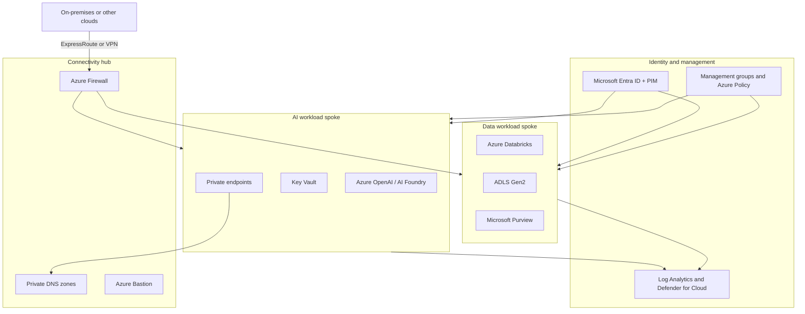

# Azure Enterprise Landing Zone for AI

> **Framing.** This is a reference architecture and an illustrative scenario. It is not a description of a named client engagement and does not claim production outcomes.

## Problem

Teams often start Azure OpenAI, AI Foundry, and Databricks work in a single subscription with public endpoints, shared credentials, and little separation between experimentation and production. That approach is enough for a proof of concept, but it does not meet enterprise expectations for identity, data residency, network isolation, or audit once models start reading business data.

This case study describes a landing zone that can host Azure AI and data workloads on a Cloud Adoption Framework (CAF) style foundation: management groups, a connectivity hub, policy-driven guardrails, and dedicated spokes for AI and data platforms.

## Requirements

### Functional

- Separate platform, identity, connectivity, and workload landing zones.
- Private connectivity to Azure OpenAI, Azure AI Foundry, Azure Storage (ADLS Gen2), Key Vault, and Databricks.
- Shared platform services for DNS, egress inspection, logging, and policy.
- Distinct spokes (or subscriptions) for development, test, and production.
- A controlled on-ramp so data-science teams can work without bypassing network or identity controls.

### Non-functional

- Align with CAF landing-zone design principles and TOGAF-style architecture governance (decision records, review gates).
- Declare a primary Azure region for AI and data; keep platform logs and policy configuration recoverable in the paired region.
- Use Microsoft Entra ID and managed identities for all compute. Avoid standing secrets on virtual machines or clusters.
- Send platform and workload diagnostics to a central Log Analytics workspace.
- Design shared connectivity and identity services for high availability (zone redundancy where the service offers it).

## Architecture

Hub traffic is inspected once. Spokes do not peer with each other by default; AI services reach data services through the hub or through explicitly approved private routes. Name resolution stays on Private DNS zones linked to the hub and spokes.

## Component choices

| Component | Choice | Rationale |
| --- | --- | --- |
| Organisation | Management groups for Platform, Landing Zones, and Sandbox | Policy inherits cleanly; sandbox stays outside production controls |
| Network | Hub-and-spoke Virtual Networks, Azure Firewall, Private DNS | Central egress and private name resolution without a full Virtual WAN unless there are many regions |
| Identity | Entra ID, managed identities, Privileged Identity Management | Removes standing admin access and passwords on compute |
| AI platform | Azure OpenAI and Azure AI Foundry behind private endpoints | Keeps prompts and completions on the private network; supports regional model hosting |
| Data platform | Azure Databricks with VNet injection, ADLS Gen2, Unity Catalog | Standard lakehouse pattern with a clear storage account boundary |
| Governance of data | Microsoft Purview plus Unity Catalog | Catalogue and lineage sit alongside platform access control |
| Secrets and keys | Azure Key Vault with Azure RBAC, optional customer-managed keys | One control plane for secrets, certificates, and encryption keys |
| Observability | Azure Monitor, Log Analytics, Defender for Cloud | Single operational and security view across spokes |
| Guardrails | Azure Policy initiatives and required tags | Prevents public network access and undeclared locations |

Companion infrastructure-as-code for a subset of these resources lives in [terraform-azure-ai-platform](https://github.com/rajeshrajput97/terraform-azure-ai-platform).

## Architecture decision records

- [ADR 0001 — Adopt a hub-and-spoke network rather than a single shared VNet](adr/0001-hub-spoke-over-single-network.md)
- [ADR 0002 — Make private endpoints the default for AI and data PaaS](adr/0002-private-endpoints-as-default.md)
- [ADR 0003 — Enforce guardrails with Azure Policy before workload deployment](adr/0003-policy-first-guardrails.md)

## Security

- Default-deny egress through Azure Firewall. Allow only approved package feeds, model endpoints, and management endpoints.
- Disable public network access on Azure OpenAI, storage, Key Vault, and Databricks workspace front ends. Use VNet injection for Databricks clusters.
- Offer customer-managed keys for storage and Azure OpenAI accounts when a regulatory requirement calls for them.
- Grant workload access through managed identities and least-privilege Azure RBAC. Route human elevation through PIM.
- Enable Microsoft Defender plans that cover storage, Key Vault, containers, and AI services.
- Require diagnostic settings on platform and AI resources by policy.

## Cost considerations

- Azure Firewall and Private Link are usually the largest *platform* costs. Use Firewall Premium only when TLS inspection or IDPS is a stated requirement.
- Keep non-production Databricks clusters on a shutdown schedule and on smaller SKUs. Cap Azure OpenAI quotas per environment.
- Use provisioned throughput for steady production inference and standard (token-based) billing for exploration.
- Prefer one central Log Analytics workspace with a commitment tier over a workspace per subscription.
- Require `env`, `cost-center`, and `workload` tags so platform spend can be allocated.

## Non-functional requirements

| Concern | Approach in this reference |
| --- | --- |
| Availability | Zone-redundant firewall and Standard Key Vault; Databricks Premium in production |
| Disaster recovery | Workloads stay in the primary region; policy, logs, and infrastructure-as-code remain recoverable in the paired region; model-deployment failover is a documented runbook, not an automatic active-active design |
| Performance | Private endpoints in the same region as callers; east-west AI traffic should not hairpin through on-premises |
| Operability | A platform team owns the hub, DNS, and policy; workload teams own spokes inside those bounds |
| Compliance | Policy denies public PaaS endpoints and unapproved regions; activity logs are retained for an organisation-defined period (an illustrative starting point is 365 days) |

## Related samples

- [terraform-azure-ai-platform](https://github.com/rajeshrajput97/terraform-azure-ai-platform)
- [enterprise-rag-azure](https://github.com/rajeshrajput97/enterprise-rag-azure)
