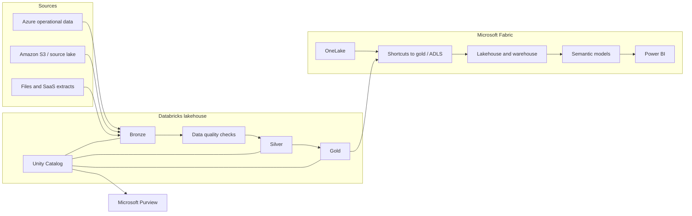

# Multi-cloud Lakehouse with Databricks and Microsoft Fabric

> **Framing.** This is a reference architecture and an illustrative scenario. It is not a description of a named client engagement and does not claim production outcomes.

## Problem

Many organisations already store operational and analytical data in more than one cloud. A typical pattern is an Azure estate used by Microsoft 365 and Power BI users, plus a second cloud (often AWS) that already holds a data lake or warehouse. Copying everything into a single vendor silo is slow and expensive. Leaving two unsupported lakes in place creates inconsistent quality rules, duplicate pipelines, and no shared catalogue.

This case study describes a multi-cloud lakehouse that uses **Databricks** as the common processing and governance engine and **Microsoft Fabric** as the Azure-native analytics and semantic layer, with OneLake shortcuts rather than wholesale duplication where that is safe.

## Requirements

### Functional

- Ingest operational data from Azure and from a second cloud (illustrated here with Amazon S3) into a medallion lakehouse (bronze, silver, gold).
- Apply one set of quality rules and one catalogue for interoperable datasets.
- Serve gold data to Power BI and Fabric experiences without requiring every analyst to use Spark.
- Allow data-science teams to train and evaluate models on the same silver and gold tables.
- Avoid unnecessary cross-cloud copy for large, rarely changing bronze data.

### Non-functional

- Keep data-residency boundaries explicit: a dataset has a home region and a home cloud.
- Encrypt data at rest with platform-managed keys by default, and with customer-managed keys where a policy requires it.
- Make access decisions in a central catalogue (Unity Catalog) and align them with Microsoft Entra ID and, where needed, AWS IAM.
- Provide lineage from source system to gold table and to a Fabric semantic model.
- Keep cross-cloud egress predictable and observable.

## Architecture

Bronze and silver processing stays in Databricks, close to the data's home cloud when volume is high. Gold products that Microsoft analysts consume are exposed to Fabric through OneLake shortcuts or a controlled copy into ADLS Gen2 / OneLake. Purview is used as the enterprise catalogue view; Unity Catalog remains the technical enforcement point for Spark and Databricks SQL.

## Component choices

| Component | Choice | Rationale |
| --- | --- | --- |
| Processing | Databricks (Azure and, where required, Databricks on AWS) | One engine and one Unity Catalog story across clouds |
| Storage | ADLS Gen2 as the Azure home; S3 as the AWS home; Delta Lake table format | Open table format reduces lock-in and supports time travel |
| Microsoft analytics | Fabric OneLake, lakehouse / warehouse, Power BI | Meets the Microsoft consumption path without rebuilding pipelines in Dataflows unless needed |
| Cross-cloud access | OneLake shortcuts or Databricks external locations, plus a justified copy for heavily queried gold | Shortcuts avoid double storage; a copy is still valid when latency or egress would dominate |
| Technical governance | Unity Catalog (schemas, grants, volumes, lineage) | Fine-grained access on tables and files used by engineering and science teams |
| Enterprise catalogue | Microsoft Purview, connected to Unity Catalog and Fabric | Business glossary and scan-based inventory for a broader audience |
| Quality | Declarative checks at the silver boundary (completeness, uniqueness, accepted values, freshness) | Failed checks block promotion to gold, as in the companion sample pipeline |
| Orchestration | Databricks Workflows or Fabric Data Factory, not both for the same job | One scheduler per pipeline to avoid split failure handling |
| Identity | Entra ID as the primary identity; AWS IAM roles for S3 access via federation | Users should not hold long-lived cloud keys |

A compact, locally runnable medallion pipeline is in [databricks-medallion-lakehouse](https://github.com/rajeshrajput97/databricks-medallion-lakehouse).

## Architecture decision records

- [ADR 0001 — Use Delta Lake as the shared table format](adr/0001-delta-lake-shared-format.md)
- [ADR 0002 — Prefer OneLake shortcuts over default cross-cloud copy](adr/0002-onelake-shortcuts-over-copy.md)
- [ADR 0003 — Enforce access in Unity Catalog and publish into Purview](adr/0003-unity-catalog-and-purview.md)

## Security

- No anonymous access to lakes. External locations in Unity Catalog map to constrained storage identities.
- Cross-cloud reads use short-lived federated credentials, not static access keys in notebooks.
- Gold products that contain personal data stay in the home region unless a transfer agreement exists.
- Row- and column-level filters in Unity Catalog protect sensitive attributes before data reaches Fabric semantic models.
- Platform logs (Databricks audit, Fabric activity, storage access) go to a central workspace in the home cloud.

## Cost considerations

- Cross-cloud egress is often the hidden cost. Measure it and prefer in-cloud processing for heavy bronze transforms.
- Shortcuts reduce duplicate storage but can still incur read egress; cache or copy only gold products with a high query rate from Fabric.
- Right-size Databricks SQL warehouses and Fabric capacity separately; do not assume one engine should serve every ad-hoc query.
- Lifecycle policies on bronze (tiering or retention) usually repay themselves faster than the same policies on gold.
- Tag pipelines and tables with a product owner so storage and compute can be charged back.

## Non-functional requirements

| Concern | Approach in this reference |
| --- | --- |
| Availability | Databricks and Fabric capacities sized independently; gold copies or caches used where a shortcut would be a single point of latency |
| Disaster recovery | Delta tables are recoverable from the storage account or S3 bucket in the home cloud; catalogue metadata is included in the backup design |
| Performance | Partition and liquid-cluster gold tables for the actual query pattern; avoid wide cross-cloud scans at query time |
| Operability | A data-platform team owns catalogues, quality gates, and storage; domain teams own silver/gold products inside those standards |
| Compliance | Residency and classification tags travel with the table; Purview reports on products that left their home cloud |

## Related samples

- [databricks-medallion-lakehouse](https://github.com/rajeshrajput97/databricks-medallion-lakehouse)
- [terraform-azure-ai-platform](https://github.com/rajeshrajput97/terraform-azure-ai-platform)
