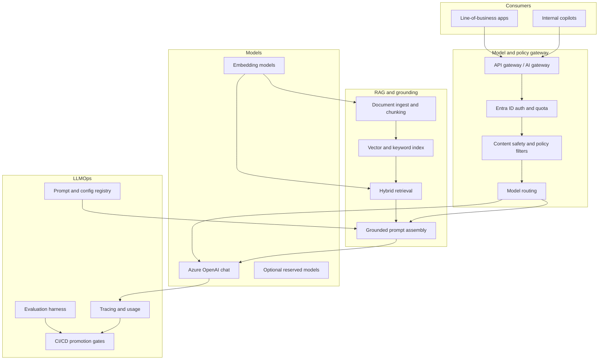

# Enterprise GenAI Platform with Governance, Guardrails, and LLMOps

> **Framing.** This is a reference architecture and an illustrative scenario. It is not a description of a named client engagement and does not claim production outcomes.

## Problem

Teams can reach a hosted large language model in an afternoon. An enterprise cannot stop there. Uncontrolled use typically produces four problems: prompts and documents leaving an approved boundary, inconsistent answers with no evaluation, no ownership of prompt or model versions, and unpredictable spend.

This case study describes a shared GenAI platform: a model gateway, a retrieval-augmented generation (RAG) path, content safety and policy guardrails, and an LLMOps loop for prompts, evaluations, tracing, and cost allocation. It is the platform pattern; a small runnable RAG sample lives in a companion repository.

## Requirements

### Functional

- Offer approved models (for example Azure OpenAI chat and embedding deployments) through a single gateway.
- Support RAG over enterprise documents with source citation.
- Apply content safety, jailbreak resistance, and allowed-topic policies on both input and output.
- Version prompts, retrieval settings, and model deployments together so a change can be promoted or rolled back.
- Record traces, token usage, and evaluation scores for every production application.
- Allow application teams to onboard a use case without taking a direct dependency on a vendor SDK.

### Non-functional

- Keep prompts, documents, and completions in an approved region and network path (see the [AI landing zone](../01-azure-enterprise-landing-zone-for-ai/README.md)).
- Meet a defined latency budget for interactive chat and a separate budget for batch jobs.
- Provide identity for callers (user or application) and attribute cost to a use-case tag.
- Make the evaluation gate blocking for production promotions.
- Design for model swap: changing a deployment should not require rewriting every application.

## Architecture

Applications never call the model resource directly in production. They call the gateway, which authenticates the caller, applies safety policy, selects a model deployment, and optionally runs the RAG path. LLMOps artefacts (prompts, retrieval configuration, evaluation reports) live alongside application code in source control, with environment promotion through CI.

## Component choices

| Component | Choice | Rationale |
| --- | --- | --- |
| Model hosting | Azure OpenAI / Azure AI Foundry deployments | Regional hosting, network isolation, and content-filter integration |
| Gateway | Azure API Management or an equivalent AI gateway in the landing zone | Auth, quota, routing, and a stable contract for applications |
| Safety | Azure AI Content Safety, plus application-level policy (allowed topics, PII redaction) | Defence in depth: platform filters and use-case rules |
| Retrieval | Hybrid keyword + vector retrieval with citations required in the prompt contract | Reduces hallucination risk for enterprise Q&A |
| Prompt management | Versioned prompt templates and retrieval settings in git, referenced by the gateway | Reviewable, rollback-friendly changes |
| Evaluation | Offline golden sets plus sampled online evaluation (groundedness, relevance, toxicity, cost) | A promotion gate needs evidence, not only a demo |
| Observability | Traces that include tool or retrieval steps, token counts, and safety decisions | Needed for incident response and cost review |
| Identity | Entra ID for users; managed identities for services | End-to-end attribution |
| Cost control | Per-use-case quotas, token budgets, and cache for repeated prompts | Prevents one experiment from consuming the platform budget |

The companion sample [enterprise-rag-azure](https://github.com/rajeshrajput97/enterprise-rag-azure) shows chunking, retrieval, prompt assembly, and a FastAPI contract with an offline stub.

## Architecture decision records

- [ADR 0001 — Place a model gateway in front of every production caller](adr/0001-model-gateway-in-front.md)
- [ADR 0002 — Require grounding and citations for enterprise question answering](adr/0002-grounded-rag-default.md)
- [ADR 0003 — Make evaluation a blocking release gate](adr/0003-evaluation-release-gate.md)

## Security

- Prompts and documents are treated as sensitive data. They stay on the private network path defined by the landing zone.
- Safety filters run on input and output. Failures are logged and, for high-risk use cases, reviewed by a human process.
- Keys to model resources are never distributed to application teams; the gateway uses a managed identity.
- RAG indexes inherit access control from the source document set. A user must not retrieve a document they could not open in the source system.
- Prompt-injection and tool-abuse cases are part of the evaluation set, not only happy-path questions.

## Cost considerations

- Token spend is allocated by use-case tag at the gateway, not estimated after the fact from a shared resource invoice.
- Cache embeddings and frequent system prompts. Re-embed only when the source document changes.
- Use a cheaper or smaller model for classification and routing; reserve the strongest chat model for tasks that need it.
- Batch and offline jobs should run on a separate quota so they cannot starve interactive users.
- Evaluation itself consumes tokens; budget it as a platform cost.

## Non-functional requirements

| Concern | Approach in this reference |
| --- | --- |
| Availability | At least two chat deployments in the primary region where the product allows it; a documented fallback model and a fail-closed policy for safety outages |
| Disaster recovery | Prompt registry and evaluation sets are in source control; indexes can be rebuilt from the source corpus; the runbook covers model-deployment loss |
| Performance | Interactive p95 latency is a use-case SLO; retrieval depth and max tokens are capped to protect that SLO |
| Operability | A platform team owns the gateway, safety policy, and model catalogue; use-case teams own prompts, indexes, and evaluations inside those rules |
| Compliance | Use-case onboarding records the data classes in scope, the human-oversight model, and the retention period for traces |

## Related samples

- [enterprise-rag-azure](https://github.com/rajeshrajput97/enterprise-rag-azure)
- [agentic-ai-orchestrator](https://github.com/rajeshrajput97/agentic-ai-orchestrator)
- [Azure enterprise landing zone for AI](../01-azure-enterprise-landing-zone-for-ai/README.md)
