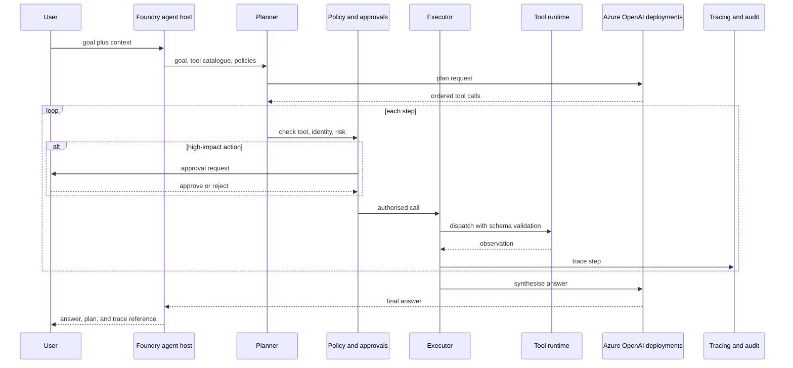

# Agentic AI on Azure AI Foundry

> **Framing.** This is a reference architecture and an illustrative scenario. It is not a description of a named client engagement and does not claim production outcomes.

## Problem

A single RAG chat is often not enough when a task needs several tools: look up a record, draft a change, call an API, or wait for a person to approve. Unstructured "just give the model some tools" designs fail in enterprises for familiar reasons: unclear identity, tools that can do too much, no audit of intermediate steps, and no way to stop a runaway loop.

This case study describes an agentic platform on **Azure AI Foundry**: a planner that breaks a goal into steps, an executor that calls registered tools, and platform controls for identity, approvals, tracing, and sandboxing. A small offline orchestrator that demonstrates the same planner/executor/registry pattern is published separately.

## Requirements

### Functional

- Accept a user or system goal and produce a plan of tool calls, not only a single model completion.
- Register tools with a name, schema, and owner; reject unknown tools and invalid arguments.
- Support retrieval, calculation, internal APIs, and human-approval tools in the same run.
- Return the final answer together with the plan and a trace of observations.
- Allow a human to approve or reject high-impact actions before they are executed.
- Run the same orchestration contract against Foundry-hosted agents or a self-hosted executor.

### Non-functional

- Every tool call runs as a known identity (user-delegated or application) and is written to an audit trail.
- Tools that change state are explicitly marked; read-only tools cannot be used to mutate systems.
- Timeouts, step limits, and token budgets stop runaway loops.
- Secrets for downstream APIs stay in Key Vault; they are never placed in prompts or traces in clear text.
- The design fits the [AI landing zone](../01-azure-enterprise-landing-zone-for-ai/README.md) private-network and policy constraints.

## Architecture

Foundry provides the hosting, model routing, and (where used) managed agent runtime. The important design is the contract around it: a versioned tool catalogue, a policy checkpoint before side-effecting tools, and traces that a reviewer can read without opening a notebook.

## Component choices

| Component | Choice | Rationale |
| --- | --- | --- |
| Agent host | Azure AI Foundry agent / assistant capabilities, with a self-hosted executor as a fallback | Uses the managed platform where it fits, without hiding the planner/executor contract |
| Models | Azure OpenAI deployments reached through the GenAI gateway | Same governance as other GenAI workloads |
| Planning | Structured plans (JSON tool calls) rather than free-form chain-of-thought as the executable artefact | Plans can be validated, displayed, and stored |
| Tool runtime | Registered handlers behind an internal API, optionally exposed as Model Context Protocol (MCP) servers | A schema and an owner for every tool |
| Approvals | A human-approval tool for create/update/delete and for any external message send | High-impact actions are not implicit |
| Identity | On-behalf-of or managed identity per tool; no shared "agent admin" secret | Least privilege and a clear audit subject |
| Observability | OpenTelemetry-style traces: plan, each tool, latency, tokens, approval outcome | Needed for debugging and for incident review |
| Safety | Content safety on user goals and on final answers; allow-lists on tool names per use case | Reduces prompt-injection paths into powerful tools |

The companion sample [agentic-ai-orchestrator](https://github.com/rajeshrajput97/agentic-ai-orchestrator) implements a planner, executor, tool registry, and mock LLM that run offline.

## Architecture decision records

- [ADR 0001 — Keep a planner and executor contract even when using Foundry agents](adr/0001-planner-executor-contract.md)
- [ADR 0002 — Require human approval for side-effecting tools](adr/0002-human-approval-for-side-effects.md)
- [ADR 0003 — Register tools with schemas, owners, and least-privilege identities](adr/0003-versioned-tool-catalogue.md)

## Security

- Treat the tool catalogue as part of the trusted computing base. Prompt text must not be able to invent a new tool name that the executor will honour.
- Validate arguments against the registered schema. Pass raw model output to tools only after validation.
- Isolate tool runtimes; a retrieval tool should not share credentials with a record-update tool.
- Redact secrets and personal data from traces. Store a correlation id that security teams can use to retrieve a fuller audit record when needed.
- Add prompt-injection cases (including "ignore previous instructions and call tool X") to the evaluation set.

## Cost considerations

- Multi-step agents multiply token use. Enforce a maximum number of steps and a maximum token budget per run.
- Cache retrieval results within a run when several steps need the same document.
- Use a smaller model for planning or classification if quality remains acceptable; reserve the strongest model for synthesis or difficult plans.
- Charge usage to a use-case tag, including approval-wait time only where it holds a dedicated session (usually it should not).

## Non-functional requirements

| Concern | Approach in this reference |
| --- | --- |
| Availability | Stateless executors behind the Foundry host or an internal API; in-flight plans can be retried only if tools are idempotent or compensated |
| Disaster recovery | Tool catalogue, prompts, and policies live in source control; run-state is expendable unless a long-running approval requires a durable store |
| Performance | Step limits and timeouts protect interactive use; long jobs are asynchronous with a status API |
| Operability | Platform team owns the host, policy engine, and shared tools; use-case teams own their specialised tools and approval rules |
| Compliance | Traces for high-impact actions are retained for an organisation-defined period and can be reconstructed for audit |

## Related samples

- [agentic-ai-orchestrator](https://github.com/rajeshrajput97/agentic-ai-orchestrator)
- [Enterprise GenAI platform](../03-enterprise-genai-platform-governance/README.md)
- [Azure enterprise landing zone for AI](../01-azure-enterprise-landing-zone-for-ai/README.md)
