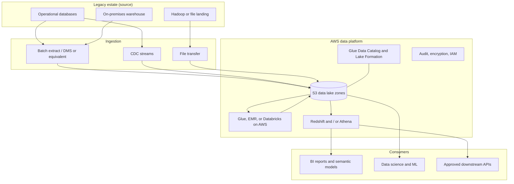

# AWS Data Platform Migration

> **Framing.** This is a reference architecture and an illustrative scenario. It is not a description of a named client engagement and does not claim production outcomes. The source estate is a typical legacy pattern (on-premises warehouse and/or Hadoop) rather than a named system.

## Problem

A common starting point is a long-lived on-premises data warehouse, sometimes with a Hadoop or file landing zone beside it, feeding a large set of overnight jobs and fixed reports. The platform is hard to scale, expensive to change, and poorly suited to newer lakehouse or machine-learning workloads. A "big bang" cutover is rarely acceptable because operational reports have to stay correct during the move.

This case study describes a phased migration to a governed **AWS data platform**: S3 as the durable lake, a warehouse or lakehouse serving layer, CDC and batch ingestion, and a dual-run period before each business product is cut over.

## Requirements

### Functional

- Land raw source data in Amazon S3 with clear bronze / silver / gold (or raw / curated / product) zones.
- Ingest both batch extracts and change-data-capture (CDC) streams from operational databases.
- Reproduce priority warehouse marts and reports with agreed reconciliation checks.
- Provide an analytical query engine for BI and a processing engine for engineering and data science.
- Retire legacy jobs in slices, not only at the end of the programme.

### Non-functional

- Maintain report correctness during dual-run, with explicit reconciliation tolerances.
- Encrypt data at rest and in transit; use least-privilege IAM and a formal account structure.
- Keep a documented RPO and RTO for the new platform; do not assume the legacy warehouse remains the only recovery path indefinitely.
- Control egress and cross-account access. Avoid public S3 buckets.
- Make cost observable by product, because warehouse and scan-based pricing models differ from the legacy licence.

## Architecture

During dual-run, a slice of reports is produced on both the legacy warehouse and the AWS serving layer. A reconciliation job compares grain, totals, and a set of control queries. Only after a slice meets its exit criteria is the legacy job retired and the consumer pointed at AWS.

## Component choices

| Component | Choice | Rationale |
| --- | --- | --- |
| Account structure | Separate accounts (or at least isolated VPCs) for landing, processing, serving, and shared services | Aligns with AWS multi-account guidance and limits blast radius |
| Lake storage | Amazon S3 with prefix or bucket-level zones, object lock or lifecycle where required | Durable, cheap storage for raw and historical data |
| Catalogue and grants | AWS Glue Data Catalog with Lake Formation (and Unity Catalog if Databricks on AWS is chosen) | Central metadata and enforced access, not only IAM on buckets |
| Ingest | AWS DMS or an equivalent CDC tool for databases; batch extracts where CDC is not viable | Reduces reliance on nightly full dumps for changing tables |
| Processing | AWS Glue and/or EMR, or Databricks on AWS when a multi-cloud Spark standard already exists | Either can implement medallion transforms; pick one primary engine per domain |
| Serving | Amazon Redshift for curated marts; Athena for exploratory and ad-hoc SQL on the lake | Matches two common consumer patterns without forcing everything into a warehouse |
| Orchestration | Amazon MWAA (Airflow) or Step Functions, one per domain | Visible schedules and retries during dual-run |
| Security | KMS customer-managed keys where policy requires, PrivateLink to AWS APIs, no public buckets | Consistent with a landing-zone baseline |
| Observability | CloudWatch, CloudTrail, and job-level quality metrics | Reconciliation evidence becomes part of operations, not a spreadsheet |

The medallion quality-gate idea is demonstrated, in portable form, in [databricks-medallion-lakehouse](https://github.com/rajeshrajput97/databricks-medallion-lakehouse).

## Architecture decision records

- [ADR 0001 — Migrate by product slices with a dual-run gate](adr/0001-sliced-dual-run-migration.md)
- [ADR 0002 — Make S3 the system of record and treat the warehouse as a serving layer](adr/0002-s3-system-of-record.md)
- [ADR 0003 — Prefer CDC for rapidly changing operational sources](adr/0003-cdc-for-operational-sources.md)

## Security

- S3 buckets block public access. Cross-account reads use Lake Formation grants or tightly scoped IAM roles, not copied keys.
- Encryption keys and logging accounts are separated from workload accounts.
- Legacy extraction hosts should push into a landing zone, not pull from a wide on-premises opening into the AWS estate.
- Personal data and other regulated classes are tagged in the catalogue and restricted before they reach ad-hoc query engines.
- Cutover runbooks include access reviews: a report consumer should not gain broader data on AWS than they had on the legacy warehouse.

## Cost considerations

- Scan-based engines (Athena, some Spark jobs) need partitioning, compression, and column formats (for example Parquet) or costs will exceed the legacy licence in surprising ways.
- Redshift sizing should follow the marts you actually serve, not a lift of every historic table.
- Dual-run is a temporary double spend. Time-box each slice and retire the legacy job when the gate is met.
- Watch ingestion and cross-AZ or hybrid data-transfer costs during CDC.
- Tag every job and dataset with a product owner for chargeback.

## Non-functional requirements

| Concern | Approach in this reference |
| --- | --- |
| Availability | Multi-AZ for serving clusters; S3 provides durability for the lake |
| Disaster recovery | Backup and restore tested for the catalogue and the serving layer; raw data in S3 is the rebuild source |
| Performance | SLOs are set per report slice; partition design is driven by those queries |
| Operability | A migration control board tracks slice status, reconciliation failures, and cutover dates |
| Compliance | Lineage from source system to AWS product is recorded before a slice is declared done |

## Related samples

- [databricks-medallion-lakehouse](https://github.com/rajeshrajput97/databricks-medallion-lakehouse)
- [Multi-cloud lakehouse with Databricks and Fabric](../02-multicloud-lakehouse-databricks-fabric/README.md)
